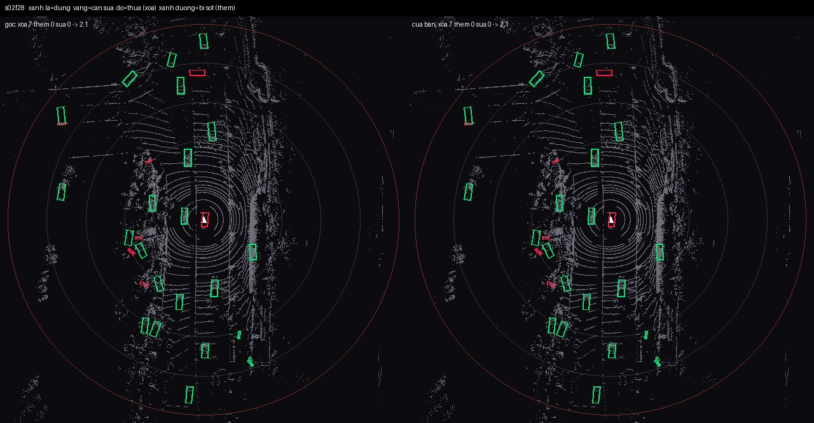

# Báo cáo Day 14 — Lê Ngọc Bích Loan — 2A202603070

> Sao chép file này thành `report/individual/<MSSV>_<HoTen>.md` (không dấu), ví dụ `2A20260000_NguyenVanAn.md`.

- Mã học viên dùng với `--student`: `070`
- `seed_tag` trong `frames_A.txt`: `393590736f`

## 1. Dự đoán trước sweep (bước 5b)

Ghi **trước** khi chạy `scripts/pp_sweep.py`, rồi commit và push ngay (lịch sử commit là bằng chứng thời điểm viết). Không sửa phần này sau khi có kết quả.

### Quan sát baseline trên tập A

Sau khi kiểm tra 3 frame tập A bằng point cloud, ảnh camera và công cụ QC bổ sung, tôi nhận thấy:

- **Lỗi phổ biến nhất tôi ghi nhận là box thừa.** Với cấu hình gốc (`score_thr=0.1`), 40/94 box có score dưới `0.4`, trong đó 14 box có score dưới `0.3`. Tôi ưu tiên rà các box có score thấp và đối chiếu camera, point cloud để xác định box nào thực sự thừa.
- **Nhóm thường cần kiểm tra kỹ** là Cyclist, Pedestrian và Car ở xa LiDAR. Các box Cyclist và Pedestrian tôi quan sát có score trong khoảng `0.14–0.45`. Trong 21 box cách LiDAR trên 35 m, có 11 box có score dưới `0.4`.
- **Nhóm dễ bị bỏ sót** gồm xe lớn (Truck, Bus) và các vật thể nhỏ hoặc bị che khuất. Mô hình PointPillars huấn luyện trên KITTI không dự đoán trực tiếp hai lớp Truck và Bus.
- **Các box tôi nghi dự đoán sai** thường có score thấp, khoảng `0.14–0.35`, hoặc nằm xa LiDAR. Tôi gặp dạng nghi vấn này ở các box Cyclist và Pedestrian.

### Dự đoán ảnh hưởng của tham số

| Tham số | Mức dự đoán | Tác động kỳ vọng | Rủi ro |
|---|---:|---|---|
| `score_thr` | `0.3` | Tăng ngưỡng từ `0.1` lên `0.3` có thể giảm số box thừa phải xóa. Tôi kỳ vọng vẫn giữ được nhiều box Car có score cao. | Có thể loại nhầm Cyclist hoặc Pedestrian thật có score thấp. |
| `min_points` | `5` | Yêu cầu ít nhất 5 điểm LiDAR trong mỗi box có thể lọc bớt các box nhiễu chứa rất ít điểm. | Vật thể thật ở xa hoặc bị che khuất cũng có thể chứa dưới 5 điểm và bị loại nhầm. |

### Cấu hình tôi dự đoán tốt nhất

- `score_thr = 0.3`
- `min_points = 5`

Tôi chọn ngưỡng `0.3` vì muốn loại bớt box thừa mà vẫn hạn chế nguy cơ bỏ sót vật thể thật. Ở baseline, 40 box có score dưới `0.4`, nên tôi dự đoán ngưỡng `0.4` có rủi ro lọc nhầm cao hơn. Thêm lại một box bị sót tốn 1,0 điểm công sửa, hơn ba lần chi phí xóa một box thừa (0,3 điểm). Tôi kỳ vọng cấu hình trên giảm tổng công sửa tính theo số box phải xóa, thêm và chỉnh sửa.

Tôi đưa ra dự đoán này dựa trên quan sát baseline của 3 frame tập A, trước khi chạy Sweep và chưa sử dụng dữ liệu tập B.

## 2. Tập A: sửa tay và tune

| Cấu hình | Xóa | Thêm | Sửa | Chi phí |
|---|---:|---:|---:|---:|
| Gốc (`score_thr=0.1`, `min_points=0`) | 8 | 0 | 0 | 2.4 |
| `best_config.json` (`score_thr=0.1`, `min_points=0`) | 8 | 0 | 0 | 2.4 |

Sweep (`scripts/pp_sweep.py`, lưới `score_thr=0.1..0.5` × `min_points=0,5,10`, 15 cấu hình × 3 frame), một số dòng tiêu biểu:

| Cấu hình | Xóa | Thêm | Sửa | Chi phí |
|---|---:|---:|---:|---:|
| 0.1 / 0 | 8 | 0 | 0 | 2.4 |
| 0.1 / 5 | 8 | 1 | 0 | 3.4 |
| 0.2 / 0 | 8 | 1 | 0 | 3.4 |
| 0.3 / 0 và 0.3 / 5 | 5 | 13 | 0 | 14.5 |
| 0.4 / 0 | 2 | 34 | 0 | 34.6 |
| 0.5 (mọi `min_points`) | | | | 49.3 |

- Tham số đã đổi trong `best_config.json`: không có (cấu hình tốt nhất trùng cấu hình gốc).
- Kết quả leave-one-out:
  ```
  s02f28: cấu hình chọn {'score_thr': '0.1', 'min_points': '0'} → 2.1 (tốt nhất có thể 2.1)
  s03f43: cấu hình chọn {'score_thr': '0.1', 'min_points': '0'} → 0.0 (tốt nhất có thể 0.0)
  s05f03: cấu hình chọn {'score_thr': '0.1', 'min_points': '0'} → 0.3 (tốt nhất có thể 0.3)
  ```
- Cấu hình có ổn định trên từng frame không? Cả 3 lượt leave-one-out đều chọn cùng cấu hình và đạt đúng chi phí tốt nhất có thể trên frame bỏ ra. Vì sao tôi vẫn chọn nó: cấu hình score_thr=0.1, min_points=0 là điểm mà việc loại thêm hộp không còn đáng. Theo bảng sweep, mỗi hộp sai tốn khoảng 0.3 để xoá tay, còn mỗi vật bị sót tốn khoảng 1.0 để thêm tay. Cách tính này là suy ra từ các dòng 8 xoá → 2.4, thêm 1 → 3.4 và 5 xoá + 13 thêm → 14.5. Nâng score_thr lên 0.2 chỉ cho 1 lần "thêm" mà số "xoá" vẫn là 8 (3.4 so với 2.4). Từ 0.3 trở lên, số vật bị sót tăng vọt (13 ở 0.3, 34 ở 0.4) nên chi phí lên 14.5 rồi 34.6. Ở 0.5 chi phí là 49.3 với mọi min_points. Đặt min_points=5 cũng không giảm được lần xoá nào mà còn làm mất 1 vật thật (thêm = 1, chi phí 3.4). Vì vậy, ngưỡng thấp kèm sửa tay (8 lần xoá, 0 thêm) rẻ hơn mọi cấu hình lọc chặt hơn. Việc chọn cấu hình trùng cấu hình gốc là kết quả của sweep, không phải do tôi quên tune: cả ba lượt leave-one-out đều chọn đúng cấu hình này và đạt chi phí tốt nhất có thể trên frame bỏ ra. Giới hạn của kết luận này là chỉ có 3 frame, nên "ổn định" nghĩa là không có bằng chứng ngược lại trong 3 frame, chưa phải bằng chứng cho dữ liệu khác.

Sửa tay tập A trên CVAT (task `D14-070-A`): chỉ xoá, không thêm và không chỉnh hộp nào.

| Frame | pp_id | Loại | Lý do xoá |
|---|---|---|---|
| 0 (s02f28) | 25 | Car (38 m phía trước) | Không có điểm LiDAR; tia xuyên qua hộp nên chỗ đó trống |
| 0 | 14 | Car (tại LiDAR) | Là chính xe thu dữ liệu |
| 0 | 21 | Cyclist (44 m) | Trùng với hộp Car pp 8 |
| 0 | 22, 23, 26, 27 | Cyclist lơ lửng | Score thấp (0.27–0.32); cam01/03/05 không thấy người lái (guideline: xe hai bánh dựng không người thì không vẽ) |
| 2 (s05f03) | 9 | Car (sát xe) | Không có điểm nào; 294 tia LiDAR xuyên qua hộp |

Frame 0: 30 → 23 hộp; frame 2: 32 → 31 hộp; frame 1 giữ nguyên. Tổng xoá 8 hộp.

## 3. Trước/sau (bước 8)



- `scripts/pp_compare.py` báo giảm 0% công sửa trên tập A (gốc 2.4, cấu hình chọn 2.4; s02f28 2.1, s03f43 0.0, s05f03 0.3).
- Cấu hình tôi dự đoán ở mục 1 (`score_thr=0.3`, `min_points=5`) có chi phí 14.5 (xóa 5, thêm 13, sửa 0) so với 2.4 của cấu hình gốc.
- Dự đoán ở mục 1 đúng hay sai? Giải thích bằng số box xóa/thêm/sửa: (TỰ VIẾT)

## 4. Tập B

Số đo từ `scripts/pp_prelabel.py --frames d14_070/frames_B.txt --config d14_070/best_config.json --gt d14_070/ref_B.json`:

| Xóa | Thêm | Sửa | Chi phí |
|---:|---:|---:|---:|
| 18 | 0 | 0 | 5.4 |

12/12 frame có nhãn; dự đoán 359 hộp, nhãn đã sửa 341 hộp.

Sửa tập B trên CVAT (task `D14-070-B`, ngày 27/11/2026, khoảng 11:34–11:40): xoá 18 hộp. Mỗi hộp đều được kiểm `pp_id` trong DETAILS trước khi xoá; không đổi nhãn, vị trí hay kích thước hộp nào. Sau khi Save, đọc lại từ server: 359 → 341 hộp, cả 18 hộp đã biến mất.

| Frame | pp_id | Loại hộp |
|---|---|---|
| s01f12 | 15 | Tại LiDAR (xe thu dữ liệu) |
| s01f33 | 17, 19 | Tại LiDAR (2 hộp chồng nhau) |
| s01f56 | 27 | Tại LiDAR |
| s02f03 | 14 | Tại LiDAR |
| s02f22 | 31 | Tại LiDAR |
| s02f22 | 20 | Rỗng (0 điểm) |
| s02f42 | 12 | Tại LiDAR |
| s02f42 | 35 | Rỗng (1 điểm) |
| s03f03 | 17 | Tại LiDAR |
| s03f21 | 21 | Tại LiDAR |
| s03f49 | 19 | Tại LiDAR |
| s03f49 | 21 | Rỗng (1 điểm) |
| s04f08 | 21 | Tại LiDAR |
| s04f39 | 11 | Tại LiDAR |
| s04f39 | 16 | Rỗng (1 điểm) |
| s04f56 | 8 | Tại LiDAR |
| s04f56 | 12 | Rỗng (1 điểm) |

- Loại box tốn công sửa nhất ở tập B: hộp Car do model dự đoán ngay tại vị trí LiDAR (chính xe thu dữ liệu), xuất hiện ở cả 12 frame (13 hộp), cùng 5 hộp rỗng 0–1 điểm.

## 5. Giới hạn

- Chỉ tune trên 3 frame tập A, nên dễ overfit.
- Model huấn luyện trên KITTI, không dự đoán được Truck/Bus.
- Chi phí là công thức (0.3·xóa + 1.0·thêm + 0.5·sửa), chưa phải thời gian sửa thật.
- Do thiếu thời gian, nhãn tham chiếu tập A và B **chỉ xoá hộp thừa**: chưa thêm vật bị sót và chưa chỉnh kích thước hay hướng các hộp còn lại. Vì vậy số "thêm" và "sửa" bằng 0 phản ánh phạm vi sửa của tôi, không có nghĩa là model không bỏ sót vật nào. Kết quả sweep cũng bị ảnh hưởng: cấu hình có ngưỡng cao bị phạt vì làm mất hộp, nhưng không được thưởng cho những vật bị sót mà tôi chưa vẽ.
- 4 hộp Cyclist ở frame 0 tập A chỉ được kiểm bằng 3 camera (cam01, cam03, cam05).

**Khai báo công cụ (RULES.md):** ngoài pre-label của lab, tôi dùng công cụ QC local tự xây (VF-QC Studio, chạy trên máy, không gửi dữ liệu ra ngoài) để gợi ý hộp nghi sai: hộp rỗng, hộp tại LiDAR, hộp trùng. Tôi tự kiểm và tự xoá từng hộp trên CVAT. Không có thay đổi nào được tool ghi tự động lên task A/B.
